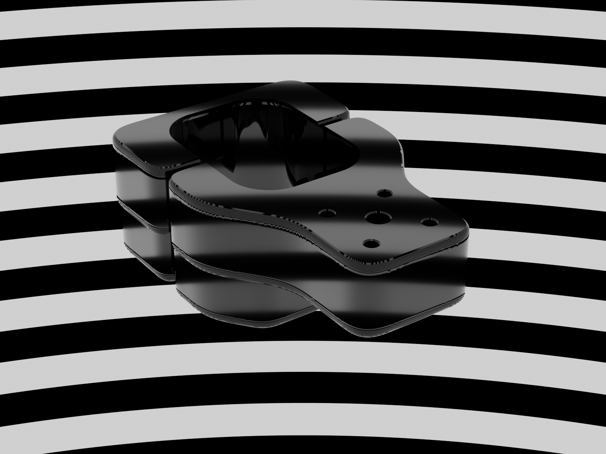
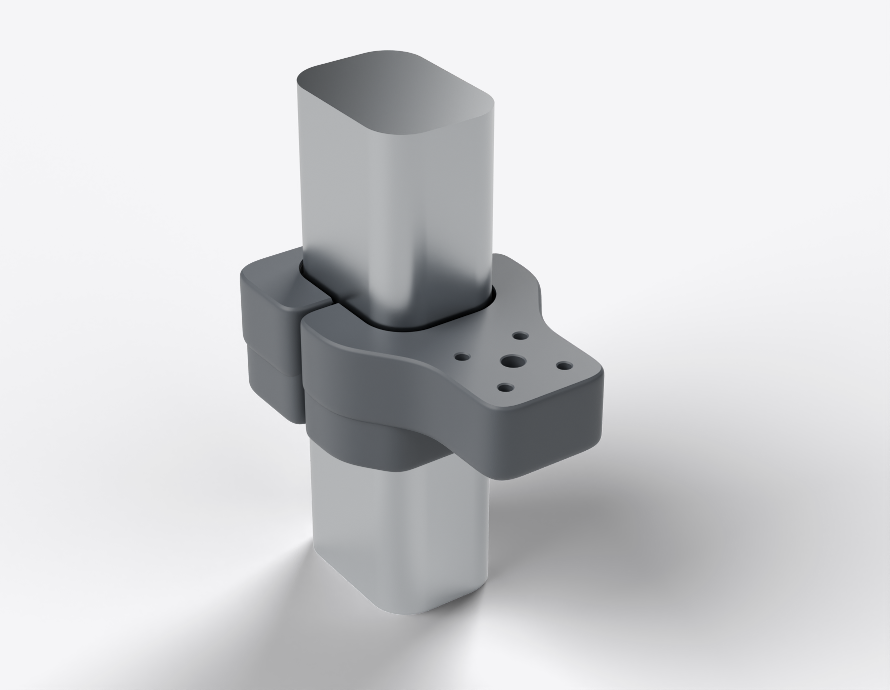

# Monitor stand holder

A PETG collar clamps the monitor-stand column through a TPU grip liner. Its top runs, as one flat plane, into a 40 mm mount face on a cantilevered pad. A three-joint arm with Hirth rosette joints stands on that face and carries a Sony ZV-E10. Every accessory has the same foot, so it bolts to the collar, the arm head, or the post.

The pictures are Cycles renders of the solids `python -m holder` checks. They are not photographs. Nothing here has been printed yet.

The design brief is [DESIGN.md](DESIGN.md). PLAN.md is the earlier band-and-block design, kept as history.

## Form

- Every printed body is a **G2 skin**: one edge profile (cap, roll, wall, roll, cap) swept round a G2 plan outline and sewn shut. No chamfer and no OCC fillet touches an outer edge, so every join is curvature continuous by construction. The build measures it on the real faces: normal step ≤ 0.5° and curvature step ≤ 2e-3 /mm across every edge.
- The one crease is the 45° lead on each print-bed edge. A roll there would overhang. The lead turns G2 into the wall.
- Plan corners are quintic G2 corners. The camera-plate walls are exact parabolas (a slight barrel). The knob crown is an exact ellipse, the carriage-bolt dome too.
- The collar is a deck over a ring set 1 mm inside it. The shadow groove runs all round, and the mount-face pad cantilevers off the ring on the deck alone.
- The head rises from its knuckle into its mount face as a loft whose width follows a quintic ogee. The knuckles are a circle blended G2 into straight sides.
- No nut is visible. The collar port nut slides in from the bore, behind the liner. The seam screw heads face the monitor (−Y), sunk in their counterbores.

| | |
| --- | --- |
|  |  |
| Side: the cantilevered pad, the knuckles, the head over J3. | Top: the G2 plan from ring to pad. |
|  |  |
| J1: base rosette, link, washer, turned knob. | Zebra stripes on the shells, to judge the G2 joins. |

## Parts

All files in `exports/` are in print pose, bed face on Z = 0, as `.step`, `.stl`, and `.3mf`. `exports/report.json` lists every check row and a hash of `src/`.

| Part | Material | Print pose (bed face, use frame) | Walls / top-bottom / infill | Stress vs layers |
| --- | --- | --- | --- | --- |
| `collar_front` | PETG | top face down | 5 / 5 / 40 % gyroid | hoop, along |
| `collar_back` | PETG | top face (MF) down | 5 / 5 / 50 % gyroid | pad cantilever, along |
| `liner_front`, `liner_back` | TPU 95A | axis vertical, end down | all perimeters, 25 mm/s | compression |
| `arm_base` | PETG | foot down | 6 / 6 / 60 % | upright root, across: checked at 1.9 MPa |
| `arm_link` (print 2) | PETG | on its side, +X face down, rosettes up | 6 / 5 / 50 % | waist bending, along |
| `arm_head` | PETG | MF down | 6 / 6 / 60 % | neck, across |
| `knob` (print 3) | PETG | base down | 4 / 5 / 40 % | hand torque |
| `zve10`, `cam_plate` | PETG | deck face down | 4 / 5 / 40 % | plate bending, along |
| `post` | PETG | foot down | 6 / 6 / 60 % | column bending, across |
| `phone`, `gopro` | PETG | foot down | 4 / 5 / 40 % | light |
| `coupon_*` | as parent | as parent | as parent | fit tests only |

Every part passes an overhang check in print pose: no down-facing surface steeper than 45° unless it is a flat ceiling within 5 mm of its edge (a bridge of 10 mm or less). Horizontal holes of 5 mm and more have a 45° teardrop roof. Wall minimum is 1.5 mm PETG (1.6 round an insert knurl) and 1.2 mm TPU, measured with solid probes.

Stress rows use a 1.0 kg payload (estimated) in the worst pose, both links level, 188.5 mm from J1 to the camera. The moment is a vector: bending about both section axes and twist, as von Mises. Sustained stress stays under 0.1 × UTS in the stress direction (PETG 38.5 MPa along layers, 19.0 across, Ultimaker TDS); peak (2×) under 0.25 × UTS.

## Hardware

Generated by `uv run python -m holder --bom`. A test fails if this table drifts from the code.

<!-- bom:start -->
| Qty | Part | Standard | Source |
| --- | --- | --- | --- |
| 2 | 1/4"-20 hex nut | ASME B18.2.2 | amesweb ASME B18.2.2 table |
| 1 | 1/4"-20 x 0.5" | ASME B18.3 | Westfield ASME B18.3 table |
| 3 | M6x35 | DIN 603 | Fabory DIN 603 M6; Aspen Fasteners DIN 603 |
| 3 | M6 nut | ISO 4032 | Wermac ISO 4032; HB&H |
| 8 | M3x10 | ISO 4762 | Westfield ISO 4762 table |
| 4 | M3x30 | ISO 4762 | Westfield ISO 4762 table |
| 12 | M3 washer | ISO 7089 | Westfield ISO 7089 |
| 4 | M6 large washer | ISO 7093-1 | fasten.it ISO 7093-1 table; Keller & Kalmbach |
| 12 | M3 heat-set insert | ruthex RX-M3x5.7 | 3djake ruthex RX-M3x5.7 table |
<!-- bom:end -->

| Joint | Screw | Grip | Into | Torque (preload) |
| --- | --- | --- | --- | --- |
| Collar seam (4) | M3 × 30 + ISO 7089 washer | 23.7 mm open, 21.7 closed | ruthex M3 insert in the back seam face | 0.05 Nm (80 N) |
| Foot to MF (8) | M3 × 10 + ISO 7089 washer | 4.7 mm (4.2 PETG + washer) | ruthex M3 insert in the MF | 0.05 Nm (80 N) |
| Arm joints (3) | DIN 603 M6 × 35 carriage bolt | 21.7 mm closed, 23.9 open (rosette lifted 2.2) | M6 nut in the knob, on an ISO 7093 washer | 0.48 Nm by hand (400 N) |
| Camera (1) | 1/4"-20 × 1/2" socket head + ISO 7093 washer | 7.6 mm | ZV-E10 socket: 4.85–5.35 mm engaged, Sony limit 5.5 | 0.5 Nm (394 N) |
| MF port (per MF) | a bought 1/4"-20 stud, not in the BOM | | 1/4" nut, dropped into its pocket | 0.3 Nm (236 N) |

Torques use F = T / (K d) with K 0.2 (estimated). The preloads come from PETG, not from the steel: under every washer, dome head and nut face the sustained bearing stress stays under 0.1 × UTS = 3.85 MPa, measured on the real seat, and an insert's pull-out shear stays under 1.10 MPa. 0.05 Nm is below most torque drivers: snug the M3 screws with two fingers on the short leg of the key until the coupon says otherwise.

Also buy for the accessories you use: a three-prong GoPro buckle and a 1/4"-20 hex bolt (head 7/16" across flats, about 4 mm tall) for `gopro`; one M3 screw as long as the phone ear plus about 10 mm, and one more ruthex insert, for `phone`; a 1/4"-20 stud for a ball head on any MF port. A 2.5 mm ball-end key at least 100 mm long reaches the `post` foot screws down its flutes.

## Install

Clamp the collar so the column top is at most **181 mm** above the collar's bottom face. The hero pose reaches back over the column; a taller column hits the arm. The build measures this limit on the solids (`column top limit` row) and the renders show the column ending 100 mm above the collar.

## Assembly

1. Press the eight M3 inserts into `collar_back` with a soldering iron: four into the seam faces, four into the mount face. Hold `collar_back` MF face down, slide the 1/4" nut in from the bore, and turn the shell over: the nut drops 1.5 mm into its pocket and cannot slide back out.
2. Snap the liners into both shells, behind the lips. The back liner covers the port nut's slot.
3. Put the halves round the column. Fit the four M3 × 30 seam screws with washers from the −Y face. Snug them crosswise to about 0.05 Nm. The seam stays open: it closes at 2.0 mm before the ribs crush flat.
4. Fix `arm_base` to the collar MF with four M3 × 10 and washers from above, before J1 goes on.
5. Press the four inserts into the `arm_head` MF. Drop its 1/4" nut in the same way: head MF face down, slide the nut in from the −Y face, turn it upright. Build J1, J2, J3: carriage bolt through (the square neck into its square hole), washer, knob. Knobs sit on +X, −X, +X. The second link is the same part turned over.
6. Fix `zve10` to the head MF with four M3 × 10 and washers. Set the camera on the plate and drive the 1/4" screw and its washer from below; the slot is outside the MF footprint, so the key reaches it.

The rosettes index in 15° steps. Lift a knob about 2.2 mm to re-index. Fine aim is the ball head's job, if you add one. Until a stud is in the head port, do not turn the head upside down: the port nut can lift out of its drop.

## What the build checks

`uv run python -m holder` builds every part, runs every check, and exits 1 before writing anything if one fails. Then it writes STEP, STL, and 3MF, reads each one back (STEP volume within 0.5 %, 3MF within 1 %), removes exports of parts that no longer exist, and writes `exports/report.json`. The same checks run in `uv run pytest`, each with a case that must fail.

- Every part is one valid solid; overhangs and walls in print pose.
- Every skin: normal step and curvature step across every edge, on the real faces. Plan and profile wires: curvature jump at every join.
- Every port nut: the max nut swept from the slot mouth to its seat meets 0 mm³ of PETG, the channel is at least the max nut across-flats + 0.15, and the nut resting in its drop moves at most 0.5 mm toward the mouth.
- Every insert: 1.6 mm of PETG round the knurl and a hole deep enough.
- Every screw: the stack rows above, measured by rays on the solids. Tip rooms are design parameters, so a longer screw fails.
- Every washer, dome head and nut face: bearing stress at its preload on the measured seat; insert pull-out shear; the rosette preload the 2× moment needs; the 2× foot bolt pull; the 2× collar tilting couple.
- The hero assembly, column and bought parts included: every pair shares at most 1e-6 mm³, except a screw and its own insert or nut, and an insert in its host. Liner rib tips sit 0.25 ± 0.02 mm off the column. The seam gap is 2.0.
- Each rosette pair meshes with 0 clash and a 0.05 to 0.15 mm flank gap.
- Each joint swept alone through 360° in 15° steps: the hero and the folded pose are inside the clear range (J1 −30° to 105°, J2 300° to 195°, J3 255° to 75°).
- A key rod (key + 1 mm, 120 mm) from each screw head misses every part present at that assembly step.
- Section stress at the collar spine root, base upright root, both link waists, head neck, plate shoulder and post column.
- The install limit: how high the column may run above the collar.

Passing CAD checks is not a printed fit. Print the coupons first, then do a 24 h hang test with the camera before trusting the arm.

## Coupons

Each coupon is a slice of the real part, so its fit is the real fit. The ring coupons are checked against the measured column, not against the part they came from.

- `coupon_collar_front`, `coupon_collar_back`, `coupon_liner_front`, `coupon_liner_back`: the ring from z 4 to 15 with the z 10 seam screws and inserts. Test the clamp on the column.
- `coupon_mf`: the collar MF block with the x +10 inserts and the 1/4" channel. Test that the inserts press in square and the nut slides in and drops.
- `coupon_rosette_base`, `coupon_rosette_link`: the J1 knuckle discs with teeth, a carriage bolt, a washer, and a knob. Test tooth quality and the 2.2 mm lift.

After the coupons:

- Collar loose on the column: lower `column_d` by 0.5 mm. Too tight: raise it.
- Insert loose or cracking the wall: change `M3_INSERT.hole_d` in `params.py`.
- Nut tight in its slot: add 0.1 mm to that nut's `pocket_af`.
- Teeth do not seat: raise `flank_fit` by 0.05 mm.

## Accessories

- `zve10`: the plate outline is the camera's footprint (115.2 × 44.8 mm, Sony help guide). The tripod-socket offset is not on that page, so the screw sits in a 24 mm slot.
- `cam_plate`: 300 × 64 mm, three camera stations (one fixed, two 40 mm slots).
- `phone`: a pocket for the bought clamp's ear between two walls, the ear screw into an insert. The ear was scaled from a photo on a 5 mm dot grid (about 16 mm wide, hole about 4.7 mm). If it does not fit, change `PHONE_EAR_W` in `src/holder/accessories.py`.
- `gopro`: a foot with a turned boss. A 1/4" bolt drops into the 13 × 5 mm pocket from below and the bought buckle threads on.
- `post`: a fluted squircle column that flares into a second MF, 88 mm up. Its MF prints face up, so the 1/4" nut seat has 45° edge strips and a 9.8 mm flat bridge.

## Open items (estimated until measured)

| Item | Value used | How to close |
| --- | --- | --- |
| Column corner radius | r 12 | Collar coupon |
| ruthex RX-M3x5.7 hole and knurl | 4.0 / 4.6 (the table columns are not labeled) | ruthex datasheet, `coupon_mf` |
| Nut factor K | 0.2 | Torque-tension test |
| M3 torque | 0.05 Nm for 80 N | Coupon |
| Knob torque | 0.48 Nm for 400 N | Coupon |
| Payload | 1.0 kg | Weigh the camera and lens |
| TPU on aluminium friction | μ 0.5 | Coupon pull test |
| Screw length tolerance | ±0.3 M3, ±0.42 M6, ±0.25 1/4" | ISO 4759-1 table |
| ZV-E10 socket offset | 24 mm slot | Calipers |
| Phone ear width and hole | 16 / 4.7 | Calipers |

## Commands

| Command | What it does |
| --- | --- |
| `uv sync` | Install build123d 0.11 and the dev tools (Python 3.12) |
| `uv run python -m holder` | Check, then write `exports/` and line previews in `out/` |
| `uv run python -m holder --bom` | Print the hardware table |
| `uv run pytest` | Every check, the negative cases, and the README BOM |
| `uv run ruff check src tests tools` | Lint |
| `uv run --with pillow python tools/render/meshes.py` | Cycles renders into `docs/renders` (needs flatpak `org.blender.Blender` 5.2) |

## Layout

`src/holder/params.py` holds every dimension, with the source of each bought part. `form.py` holds the curves and the G2 skin (corners, blends, edge rules, the curvature probe). `common.py` holds the checks, captive nuts, inserts, bearing and section probes, the surface-continuity probe, and the bought solids. `mount.py` is the MF-40 face and the foot. `collar.py`, `arm.py`, and `accessories.py` build parts and return `checks()`; they never export. `stacks.py` picks screw lengths. `assembly.py` places everything, measures the stacks, loads and the install limit. `export.py` writes files and does not repair geometry.
