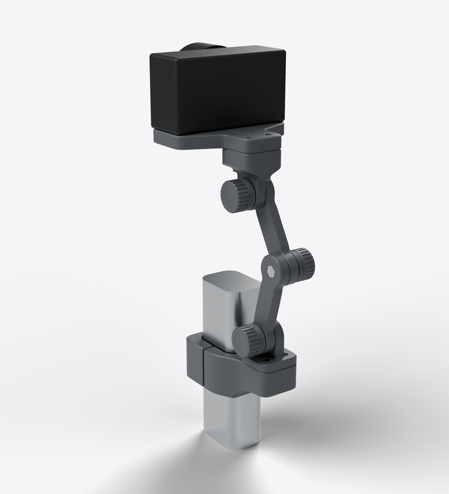
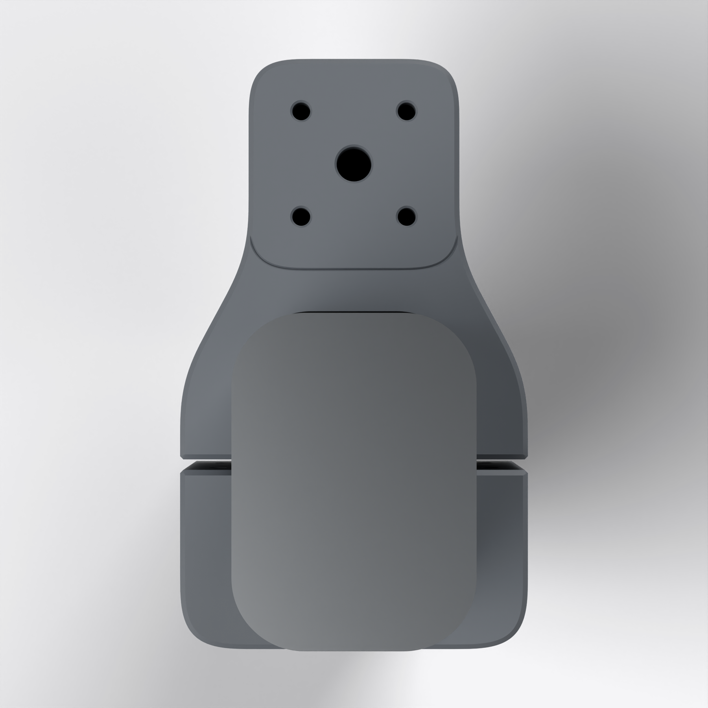
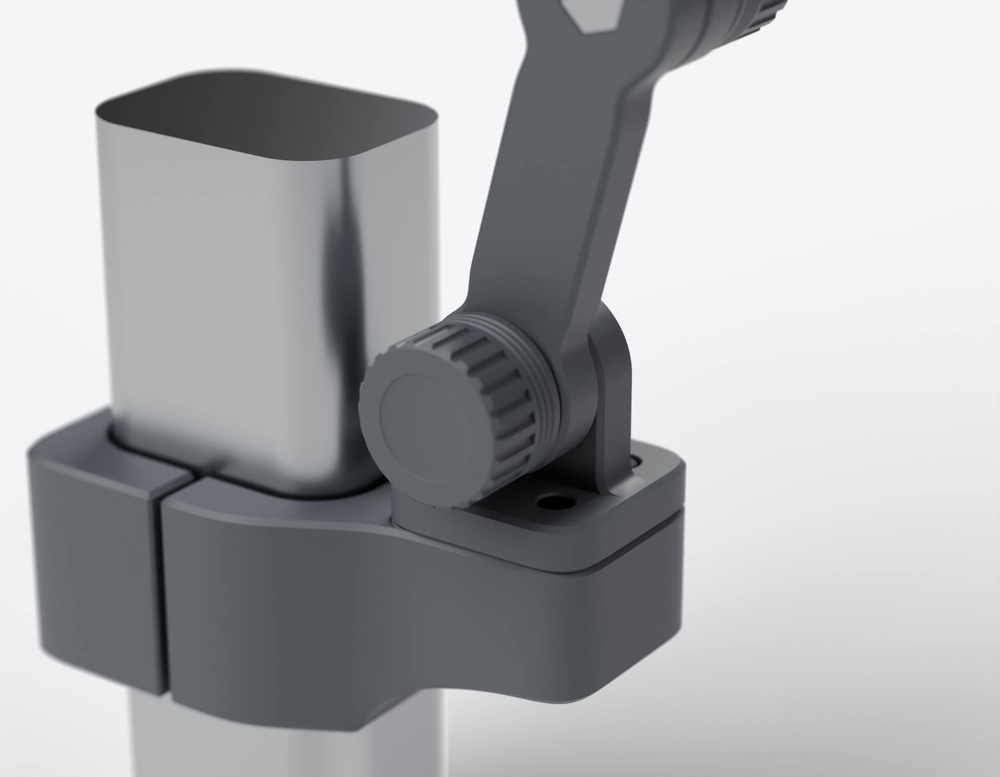
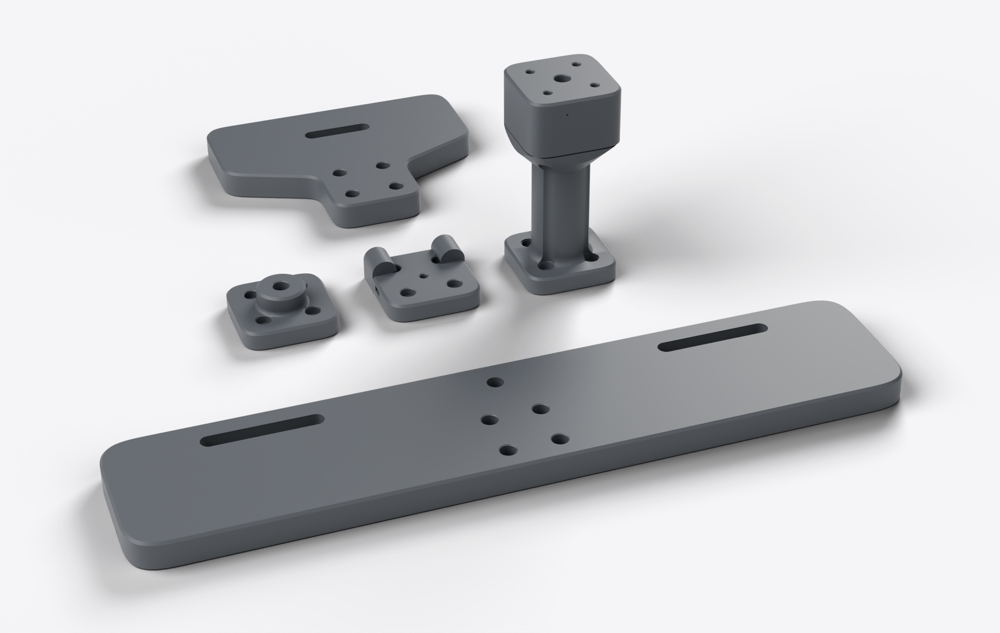

# Monitor stand holder

A PETG collar clamps the monitor-stand column through a TPU grip liner. Its top runs, as one flat plane, into a 40 mm mount face. A three-joint arm with Hirth rosette joints stands on that face and carries a Sony ZV-E10. Every accessory has the same foot, so it bolts to the collar, the arm head, or the post.

The pictures are Cycles renders of the solids `python -m holder` checks. They are not photographs. Nothing here has been printed yet.

The design brief is [DESIGN.md](DESIGN.md). PLAN.md is the earlier band-and-block design, kept as history.

## Form

- Plan outlines are straight lines joined by quintic G2 corners: curvature is zero where a corner meets a side, so the join shows no line. The link waist joins its end circles with a G2 blend that matches the circle's curvature. `checks()` measures the curvature jump at every join on the real edges (≤ 1e-3 /mm).
- The spine under the mount face is an elliptic scoop (an exact conic in STEP). The back shell is a plan prism cut by that side profile.
- One edge vocabulary: 1.0 × 45° on the outer loops, 0.6 on bed edges and on the seam (it reads as a V shadow line), 0.4 lead-ins on hole mouths, and a V groove on the collar top that traces the foot outline.
- No nut is visible. The collar nuts slide in from the bore and the liner covers their slots. The head nuts slide in from the −Y face, under the camera deck. The seam screw heads face the monitor (−Y), 5 mm below the rim.
- The head narrows from the 40 mm MF to the 10 mm knuckle with a G2 ogee (zero curvature at both ends), cut from the front view.

| | |
| --- | --- |
|  |  |
| Side: the scoop, the knuckles, the head over J3. | Top: the G2 plan from ring to pad. |
|  |  |
| J1: base rosette, link, washer, turned knob. | Zebra stripes on the shells, to judge the G2 joins. |

## Parts

All files in `exports/` are in print pose, bed face on Z = 0, as `.step`, `.stl`, and `.3mf`. `exports/report.json` lists every check row and a hash of `src/`.

| Part | Material | Print pose (bed face, use frame) | Walls / top-bottom / infill | Stress vs layers |
| --- | --- | --- | --- | --- |
| `collar_front` | PETG | top face down | 5 / 5 / 40 % gyroid | hoop, along |
| `collar_back` | PETG | top face (MF) down | 5 / 5 / 50 % gyroid | spine bending, along |
| `liner_front`, `liner_back` | TPU 95A | axis vertical, end down | all perimeters, 25 mm/s | compression |
| `arm_base` | PETG | foot down | 6 / 6 / 60 % | upright root, across: checked at 1.9 MPa |
| `arm_link` (print 2) | PETG | on its side, +X face down, rosettes up | 6 / 5 / 50 % | waist bending, along |
| `arm_head` | PETG | MF down | 6 / 6 / 60 % | neck, across |
| `knob` (print 3) | PETG | base down | 4 / 5 / 40 % | hand torque |
| `zve10`, `cam_plate` | PETG | foot down | 4 / 5 / 40 % | plate bending, along |
| `post` | PETG | foot down | 6 / 6 / 60 % | column bending, across |
| `phone`, `gopro` | PETG | foot down | 4 / 5 / 40 % | light |
| `coupon_*` | as parent | as parent | as parent | fit tests only |

Every part passes an overhang check in print pose: no down-facing surface steeper than 45° unless it is a flat ceiling within 5 mm of its edge (a bridge of 10 mm or less). Horizontal holes of 5 mm and more have a 45° teardrop roof. Horizontal hex pockets have a flat on top. Wall minimum is 1.5 mm PETG and 1.2 mm TPU, measured with solid probes.

The stress rows use a 1.0 kg payload (estimated) at the worst lever: both links level plus the camera deck, 188.5 mm from J1. Sustained stress must stay under 0.1 × UTS in the stress direction (PETG 38.5 MPa along layers, 19.0 across, Ultimaker TDS). Peak (2×) under 0.25 × UTS.

## Hardware

Generated by `uv run python -m holder --bom`. A test fails if this table drifts from the code.

<!-- bom:start -->
| Qty | Part | Standard | Source |
| --- | --- | --- | --- |
| 2 | 1/4"-20 hex nut | ASME B18.2.2 | amesweb ASME B18.2.2 table |
| 1 | 1/4"-20 x 0.375" | ASME B18.3 | Westfield ASME B18.3 table |
| 3 | M6x30 | ISO 4017 | estimated: ISO 4017 head |
| 12 | M3 nut | ISO 4032 | Wermac ISO 4032; HB&H |
| 3 | M6 nut | ISO 4032 | Wermac ISO 4032; HB&H |
| 8 | M3x12 | ISO 4762 | Westfield ISO 4762 table |
| 4 | M3x35 | ISO 4762 | Westfield ISO 4762 table |
| 4 | M3 washer | ISO 7089 | Westfield ISO 7089 |
| 3 | M6 washer | ISO 7089 | Westfield ISO 7089; Fabory |
<!-- bom:end -->

Screw lengths come from the stack of each joint, measured on the placed solids (grip under the head to the nut face, the open and closed states, the short and the long end of the length tolerance):

| Joint | Screw | Grip | Nut or socket |
| --- | --- | --- | --- |
| Collar seam (4) | M3 × 35 with washer | 28.1 mm open, 26.1 closed | M3 nut in collar_back, slot into the bore |
| Foot to MF (8) | M3 × 12, no washer | 6.7 mm (4.7 foot + 2.0 MF roof) | M3 nut 2.0 under the MF face |
| Arm joints (3) | M6 × 30 hex head | 18.6 mm open (rosette lifted 2.2), 16.4 closed | M6 nut in the knob, on a washer |
| Camera (1) | 1/4"-20 × 3/8" socket head | 5.0 mm plate | ZV-E10 socket: 4.3 to 4.8 mm engaged, Sony limit 5.5 |

Also buy for the accessories you use: a three-prong GoPro buckle and a 1/4"-20 hex bolt (head 7/16" across flats, about 4 mm tall) for `gopro`; one M3 screw as long as the phone ear plus about 10 mm for `phone` (its tip runs on into the MF port bore); a 1/4"-20 stud for a ball head on any MF port. A 2.5 mm ball-end key at least 100 mm long reaches the `post` foot screws down its flutes.

## Assembly

1. Slide the M3 nuts and the 1/4" nut into the collar_back MF channels from the bore, far nut first. Slide the four seam nuts in from the bore.
2. Snap the liners into both shells, behind the lips. They cover the slots and keep the nuts in.
3. Put the halves round the column. Fit the four M3 × 35 seam screws with washers from the −Y face. Tighten crosswise to about 0.4 Nm (estimated; confirm on the coupon). The seam stays open: it closes at 2.0 mm before the ribs crush flat.
4. Fix `arm_base` to the collar MF with four M3 × 12 from above, before J1 goes on.
5. Slide four M3 nuts and the 1/4" nut into the `arm_head` MF channels from its −Y face, under where the camera deck will sit. Build J1, J2, J3: M6 bolt head in its hex pocket, washer in its recess, knob. Knobs sit on +X, −X, +X. The second link is the same part turned over.
6. Fix `zve10` to the head MF with four M3 × 12. Set the camera on the plate and drive the 1/4" screw from below; the slot is outside the MF footprint, so the key reaches it.

The rosettes index in 15° steps. Lift a knob about 2.2 mm to re-index. Fine aim is the ball head's job, if you add one.

## What the build checks

`uv run python -m holder` builds every part, runs every check, and exits 1 before writing anything if one fails. Then it writes STEP, STL, and 3MF, reads each one back (STEP volume within 0.5 %, 3MF within 1 %), removes exports of parts that no longer exist, and writes `exports/report.json`. The same checks run in `uv run pytest`, each with a case that must fail.

- Every part is one valid solid; overhangs and walls in print pose.
- Every captive nut: the max nut swept from the slot mouth to its seat meets 0 mm³ of PETG, and the channel is at least the max nut across-flats + 0.15.
- Every screw: the stack rows above, on the solids. The tip bore floor is read by a ray, so a tip in solid PETG fails.
- The hero assembly, column and bought parts included: every pair shares at most 1e-6 mm³, except a screw and its own nut. Liner rib tips sit 0.25 ± 0.02 mm off the column. The seam gap is 2.0.
- Each rosette pair meshes with 0 clash and a 0.05 to 0.15 mm flank gap.
- Each joint swept alone through 360° in 15° steps: the hero and the folded pose are inside the clear range.
- A key rod (key + 1 mm, 120 mm) from each screw head misses every part present at that assembly step.
- Section stress at the base root, link waist, head neck, post column, and plate shoulder.

Passing CAD checks is not a printed fit. Print the coupons first, then do a 24 h hang test with the camera before trusting the arm.

## Coupons

Each coupon is a slice of the real part, so its fit is the real fit.

- `coupon_collar_front`, `coupon_collar_back`, `coupon_liner_front`, `coupon_liner_back`: the ring from z 4 to 16 with the z 10 seam screws. Test the clamp on the column.
- `coupon_mf`: the collar MF block with one M3 channel and the 1/4" channel. Test that the nuts slide in and hold.
- `coupon_rosette_base`, `coupon_rosette_link`: the J1 knuckle discs with teeth, an M6 bolt, a washer, and a knob. Test tooth quality and the 2.2 mm lift.

After the coupons:

- Collar loose on the column: lower `column_d` by 0.5 mm. Too tight: raise it.
- Nut tight in its slot: add 0.1 mm to that nut's `pocket_af` in `params.py`.
- Teeth do not seat: raise `flank_fit` by 0.05 mm.

## Accessories

- `zve10`: the plate outline is the camera's footprint (115.2 × 44.8 mm, Sony help guide). The tripod-socket offset is not on that page, so the screw sits in a 24 mm slot.
- `cam_plate`: 300 × 64 mm, three camera stations (one fixed, two 40 mm slots). Three ZV-E10 bodies do not fit side by side; use `zve10` for that camera.
- `phone`: a pocket for the bought clamp's ear between two walls. The ear was scaled from a photo on a 5 mm dot grid (about 16 mm wide, hole about 4.7 mm). If it does not fit, change `PHONE_EAR_W` in `src/holder/accessories.py`.
- `gopro`: a foot with a turned boss. A 1/4" bolt drops into the 13 × 5 mm pocket from below and the bought buckle threads on.
- `post`: a fluted column and a second MF, 88 mm up. Its MF prints face up, so the 1/4" nut seat has 45° edge strips and a 9.8 mm flat bridge.

## Open items (estimated until measured)

| Item | Value used | How to close |
| --- | --- | --- |
| Column corner radius | r 12 | Collar coupon |
| ISO 4017 M6 head | s 10.0, k 4.0 | Supplier sheet or calipers |
| Payload | 1.0 kg | Weigh the camera and lens |
| M3 into a PETG nut pocket | 0.4 Nm | Coupon to failure |
| TPU on aluminium friction | μ 0.5 | Coupon pull test |
| Screw length tolerance | ±0.3 M3, ±0.42 M6, ±0.25 1/4" | ISO 4759-1 table |
| ZV-E10 socket offset | 24 mm slot | Calipers |
| Phone ear width and hole | 16 / 4.7 | Calipers |

## Commands

| Command | What it does |
| --- | --- |
| `uv sync` | Install build123d 0.11 and the dev tools (Python 3.12) |
| `uv run python -m holder` | Check, then write `exports/` and line previews in `out/` |
| `uv run python -m holder --bom` | Print the hardware table |
| `uv run pytest` | Every check, the negative cases, and the README BOM |
| `uv run ruff check src tests tools` | Lint |
| `uv run --with pillow python tools/render/meshes.py` | Cycles renders into `docs/renders` (needs flatpak `org.blender.Blender` 5.2) |

## Layout

`src/holder/params.py` holds every dimension, with the source of each bought part. `form.py` holds the curves (G2 corners and blends, teardrops, the curvature probe). `common.py` holds the checks, captive nuts, bought solids, and stacks. `mount.py` is the MF-40 face and the foot. `collar.py`, `arm.py`, and `accessories.py` build parts and return `checks()`; they never export. `assembly.py` places everything and measures the stacks. `export.py` writes files and does not repair geometry.
