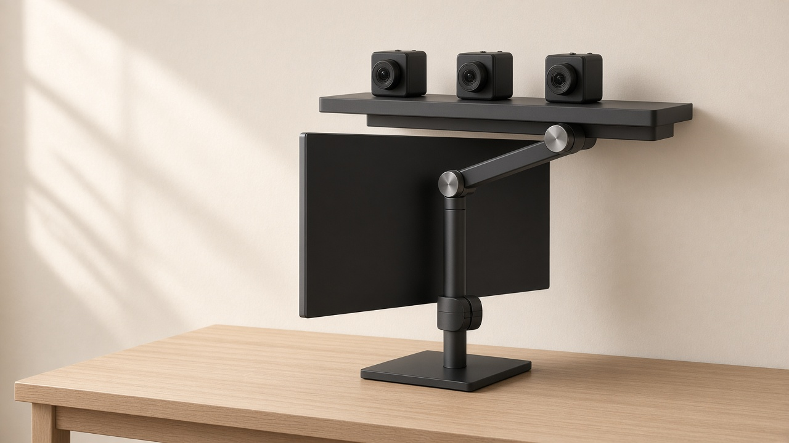
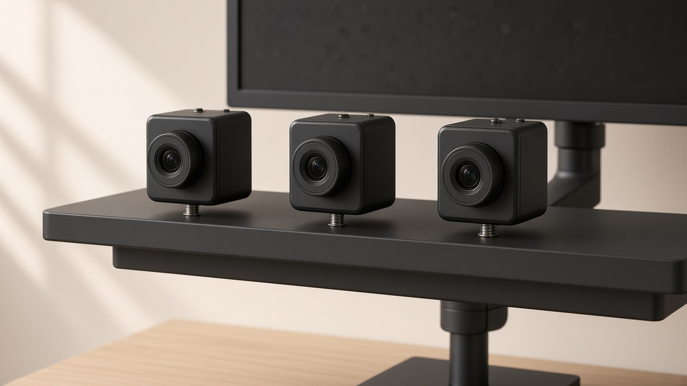
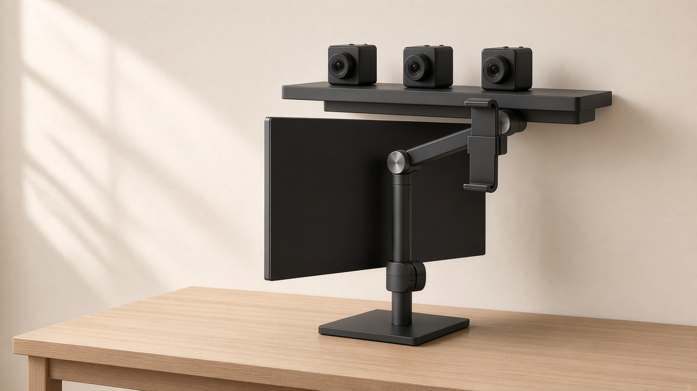
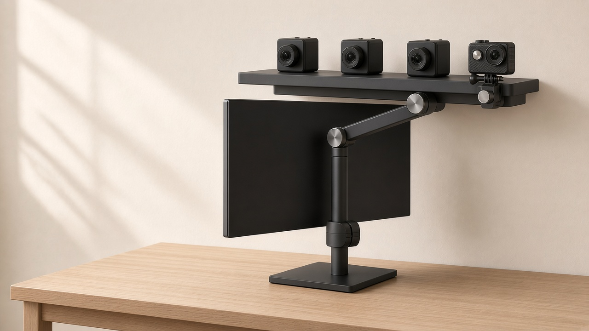

# Monitor stand holder

A TPU band clamps the column of the monitor stand. A two-hinge arm on that band holds a wide shelf behind the top of the screen. Three cameras bolt to the shelf on 1/4"-20 screws. The same screw takes a phone cradle or a GoPro buckle.

The band, the coupon, and the L block are in the model. The arm, the shelf, and the two studs are the arrangement in these pictures. They are not exported yet. Dimensions for the modeled parts are in `PLAN.md`.

## Shelf

The shelf is a PETG plate, about 300 × 60 × 8 mm, level behind the top edge of the screen. Three slots run along the plate, so the center spacing can sit between 70 and 110 mm. Each station is a 1/4"-20 clearance hole, 6.6 mm. The screw comes up from below and goes about 5 mm into the camera's tripod socket. Screw length is the 8 mm plate plus that 5 mm. A longer screw bottoms out in the socket.

Both hinges turn about the left-right axis. The lower hinge sets the height and how far the plate sits behind the panel. The upper hinge levels the plate. An M6 knob, a toothed disc, and steel washers lock each hinge. PETG against PETG creeps under three cameras.

The foot of the arm bolts to the top face of the block: four M3 nuts on a 20 mm square, and one 1/4"-20 nut in the center. The nuts sit in side slots. There are no heat-set inserts.

## Phone cradle

The cradle has one ear and one hole. A 1/4"-20 stud, about 8 mm of thread, sticks out of the side of the upper link. The ear sits in a pocket as deep as the ear, and a knob clamps it. The three camera stations stay free.

## GoPro

The camera body has two fingers, not a 1/4" thread. A bought three-prong buckle with a female 1/4"-20 thread screws onto a stud at the end of the shelf. The camera's own thumbscrew sets the tilt. Print the stud. Buy the buckle. Printed prongs snap.

## Quick start

From the repo root, with Python 3.12 and `rsvg-convert`:

1. `uv sync`
2. `uv run python -m holder`

That builds every modeled part, runs `checks()`, and writes `exports/` plus PNG previews in `out/`. A failed check exits before export. `exports/` is committed. `out/` is not.

## Commands

| Command | Description |
| --- | --- |
| `uv run python -m holder` | Check, then write STEP, STL, and 3MF into `exports/`, and PNG into `out/` |
| `uv run pytest` | Run `checks()`, the negative tests, and a STEP round-trip |
| `uv run ruff check src tests` | Lint |

## Modeled parts

`exports/` holds `coupon_front`, `coupon_back`, `coupon_strip`, `band_front`, `band_back`, and `block`. Each has `.step`, `.stl`, and `.3mf`. The same names in `out/` are PNG line previews. Files are in print orientation, bed face on Z = 0. The release attaches the same STEP, STL, and 3MF files.

| Part | Material | Bed |
| --- | --- | --- |
| `coupon_front`, `coupon_back` | TPU 95A | bottom |
| `coupon_strip` | PETG | bottom |
| `band_front`, `band_back` | TPU 95A | bottom, band axis vertical |
| `block` | PETG | on its side (−X face down) |

Print the coupon first (about 25 minutes). The band halves should clamp with the 4 mm seam gap still open. The M3 nut and the 1/4" nut should press into the strip and hold. The strip is a fit check, not part of the assembly.

Passing CAD checks is not a printed fit. The coupon, then a day with a phone on the arm, is the proof.

## Print

- Band: TPU 95A, 25 mm/s, 4 walls, 100% infill in the boss.
- Block: PETG, 4 walls, 40% gyroid. Horizontal holes print about 0.15 mm small. The 3.4 mm through-hole covers that.
- Plate is 12 mm deep (nut plus a wall on both sides). The arm section is 16 mm so the 1/4" pocket stays above the arm.

## Hardware

- 4 × M3×20 + washer + nut (seams)
- 4 × M3×16 + nut (boss to block)
- 4 × M3 nut (top face)
- 1 × 1/4"-20 nut (top face)
- For each camera: 1 × 1/4"-20 screw, plate thickness plus 5 mm
- For the phone ear or the GoPro buckle: 1 × 1/4"-20 stud, about 8 mm of thread above the face
- 2 × M6 knob, toothed disc, and steel washers (the two hinges)

## After the coupon

Leave `column_d` and each nut's across-flats alone until the coupon has been printed.

- Band too loose: lower `column_d` by 1 mm.
- Band does not fit: raise the binding dimension by 1 mm.
- Nut pocket too tight: add 0.1 mm to that pocket's across-flats.

`column_r` (12 mm) and the 1/4" pocket (11.4 mm across-flats, 5.8 mm thick) are estimates. The coupon is how you confirm the 1/4" nut. The shelf length is an estimate too: measure one camera body before locking the 70–110 mm slot range.

## Layout

`src/holder/params.py` holds the frozen dimensions. Part modules build geometry and return `checks()`. They do not export. `export.py` writes STEP and STL and does not repair geometry. Builders and pytest both run the same checks.
