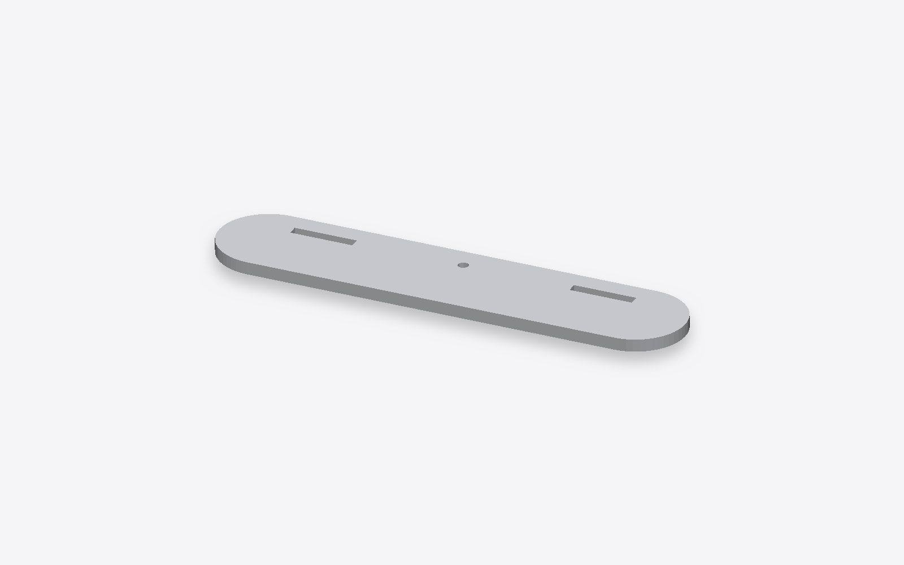
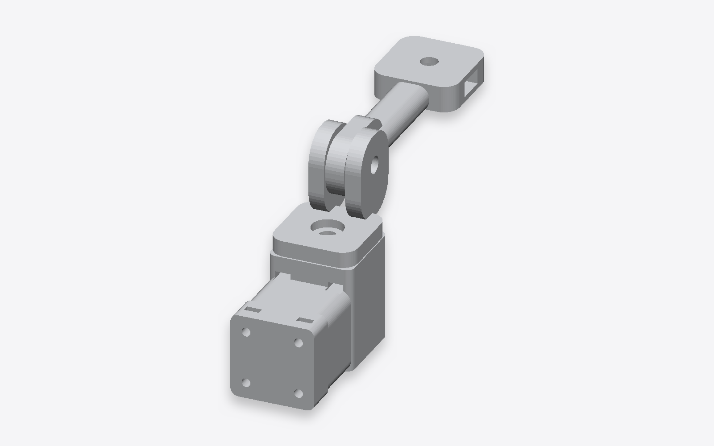
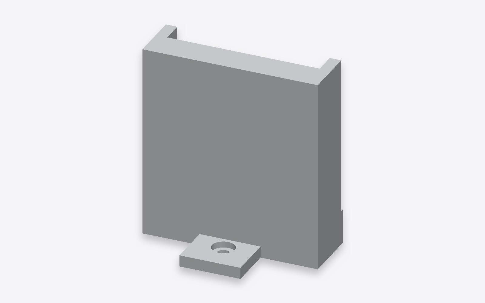
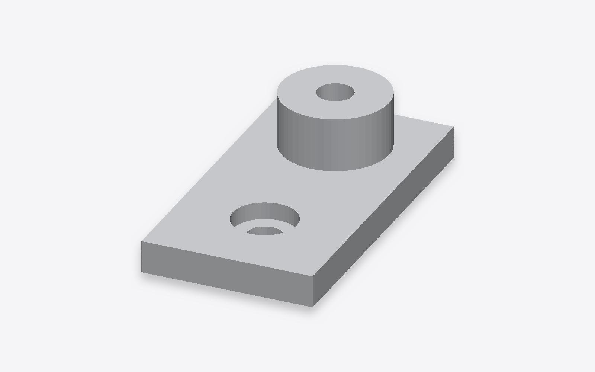
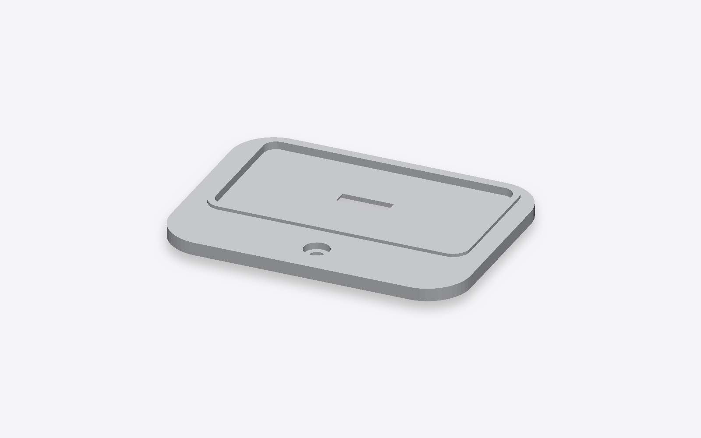
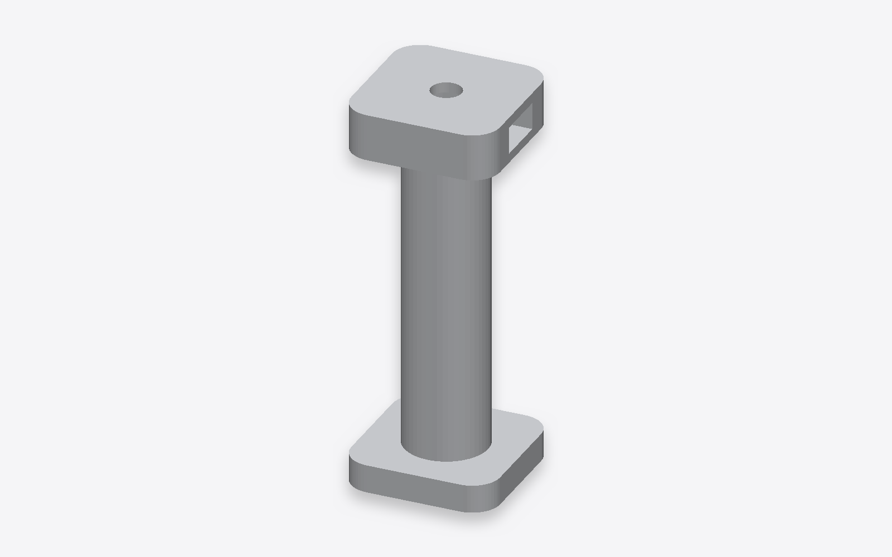

# Monitor stand holder

A TPU band clamps the column of the monitor stand. A PETG block on that band has one 1/4"-20 nut. Every accessory below bolts to that nut, or to the same nut on an arm or a post.

The pictures are rasters of the current STL meshes. They are not photographs. Rebuild them with `uv run --with numpy --with pillow python tools/render_gallery.py`.

Outer corners are circular arcs, so those surfaces are cylinders.

## Shelf

`cam_plate` is a PETG plate, 300 × 64 × 8 mm. The center camera hole is fixed. Each side slot lets that camera sit 70 to 110 mm from the center. The screw comes up from below and goes about 5 mm into the camera. Screw length is the 8 mm plate plus that 5 mm. A longer screw bottoms out in the socket.

The plate's own mounting hole is a separate 6.6 mm hole at the back, with the screw head on top. That screw goes down into a mount-face nut. One screw cannot hold both the plate and a camera.

Three Sony ZV-E10 bodies do not fit on this plate. The body is 115.2 mm wide. Use `zve10` for that camera.

## Arm

`hinge_base` plus `hinge_link` is one hinge. Add `hinge_mid` between them for two hinges. Each joint is an M6 clearance hole, 6.6 mm. The knob, the washers, and a toothed disc are bought. They are not in the model. PETG against PETG creeps, so do not run the joint without the washers.

The outer link ends in a 32 mm face with a captive 1/4"-20 nut. The slot for that nut opens to the side. Any foot in this set bolts to that face the same way it bolts to the block.

## Phone

`phone` is a pocket for the clamp you already have. Do not print another cradle. The ear slides in from the open end. Two walls, 19 mm apart, stop it spinning. An M3 screw comes down through the ear into a captive M3 nut. The walls are open on top, so ear thickness does not have to match. The foot still bolts down with a 1/4"-20 screw.

The ear was scaled from a photo on a 5 mm dot grid, not calipered. That scale reads the ear about 16 mm wide and the hole about 4.7 mm, so a 1/4" screw does not pass the hole. If the ear does not fit, change `PHONE_EAR_W` in `src/holder/accessories.py`.

## GoPro

The camera has two fingers, not a 1/4" thread. Buy the three-prong buckle. Do not print the prongs.

`gopro` is a foot with a boss. A 13 mm pocket, 5 mm deep, opens through the bottom. Drop a 1/4"-20 screw in so the thread sticks out of the boss, then bolt the foot down. The mount face closes the pocket, and the bought buckle threads onto the screw. The 13 × 5 mm pocket is not checked against a specific screw.

## ZV-E10

Sony lists the body as 115.2 × 64.2 × 44.8 mm from grip to monitor. The tripod-socket offset is not on that page, so `zve10` uses a 24 mm slot. The screw comes up from below. The hole at the back of the plate bolts to a mount face.

## Post

`post` is a foot, an 18 mm column, and a mount face on top. The top nut is the same captive 1/4"-20 nut as the block. A bought ball head can use that screw and no other part. The ball head is not modeled.

## Quick start

From the repo root, with Python 3.12 and `rsvg-convert`:

1. `uv sync`
2. `uv run python -m holder`

That builds every modeled part, runs `checks()`, and writes `exports/` plus PNG line previews in `out/`. A failed check exits before export. `exports/` is committed. `out/` is not.

## Commands

| Command | Description |
| --- | --- |
| `uv run python -m holder` | Check, then write STEP, STL, and 3MF into `exports/`, and PNG into `out/` |
| `uv run pytest` | Run `checks()`, the negative tests, and a STEP round-trip |
| `uv run ruff check src tests tools` | Lint |
| `uv run --with numpy --with pillow python tools/render_gallery.py` | Shade `docs/renders` from STL meshes |

## Modeled parts

Each name in `exports/` has `.step`, `.stl`, and `.3mf`. Files are in print orientation, bed face on Z = 0. [v0.3.0](https://github.com/w0rxbend/monitor-stand-extenstions/releases/tag/v0.3.0) attaches those files. `out/` holds line previews only.

| Part | Material | What it is |
| --- | --- | --- |
| `coupon_front`, `coupon_back` | TPU 95A | Column fit coupon |
| `coupon_strip` | PETG | Nut fit coupon |
| `band_front`, `band_back` | TPU 95A | Column clamp |
| `block` | PETG | Foot on the band. 4× M3 and one 1/4"-20 on top |
| `cam_plate` | PETG | Three camera stations |
| `hinge_base`, `hinge_link` | PETG | One hinge |
| `hinge_mid` | PETG | Extra hinge between those two |
| `phone` | PETG | Pocket for the bought ear |
| `gopro` | PETG | Stud foot for a bought buckle |
| `zve10` | PETG | One ZV-E10 |
| `post` | PETG | Raised mount face |

Print the coupon first (about 25 minutes). The M3 nut and the 1/4" nut should press into the strip and hold. The strip is a fit check, not part of the assembly.

The rib tips clear the column by the TPU fit, 0.25 mm. The coupon has not been printed. `column_r` (12 mm) and the 1/4" pocket (11.4 mm across-flats, 5.8 mm thick) are estimates.

The phone ear width and hole size are from that photo scale. Passing CAD checks is not a printed fit.

## Print

- Band: TPU 95A, 25 mm/s, 4 walls, 100% infill in the boss.
- Block and the accessories: PETG, 4 walls, 40% gyroid. Horizontal holes print about 0.15 mm small.
- The block lies on its side (−X down) so the nut slots stay off the bed. The accessories lie on their foot (Z down).

## Hardware

- 4 × M3×20 + washer + nut (band seam, 16.6 mm under the head)
- 4 × M3×25 + nut (boss to block, 20.3 mm under the head)
- 4 × M3 nut (block top)
- 1 × 1/4"-20 nut in the block, plus one in each mount face you use (`hinge_link`, `post`, and each camera does not use a nut in the plate)
- Each camera: 1 × 1/4"-20 screw, plate thickness plus about 5 mm
- Each foot: 1 × 1/4"-20 screw into the mount-face nut
- GoPro: one more 1/4"-20 screw as the stud, and a bought three-prong buckle
- Phone: the bought clamp, plus one M3 nut and an M3 screw about as long as the ear plus 6 mm
- Each hinge: 1 × M6 bolt, knob, and steel washers

## After the coupon

Leave `column_d` and each nut's across-flats alone until the coupon has been printed.

- Band too loose: lower `column_d` by 1 mm.
- Band does not fit: raise the binding dimension by 1 mm.
- Nut pocket too tight: add 0.1 mm to that pocket's across-flats.

## Layout

`src/holder/params.py` holds the frozen column and fastener dimensions. Accessory dimensions that are not on the column live in `src/holder/accessories.py`. Part modules build geometry and return `checks()`. They do not export. `export.py` writes STEP, STL, and 3MF and does not repair geometry. Builders and pytest both run the same checks.
