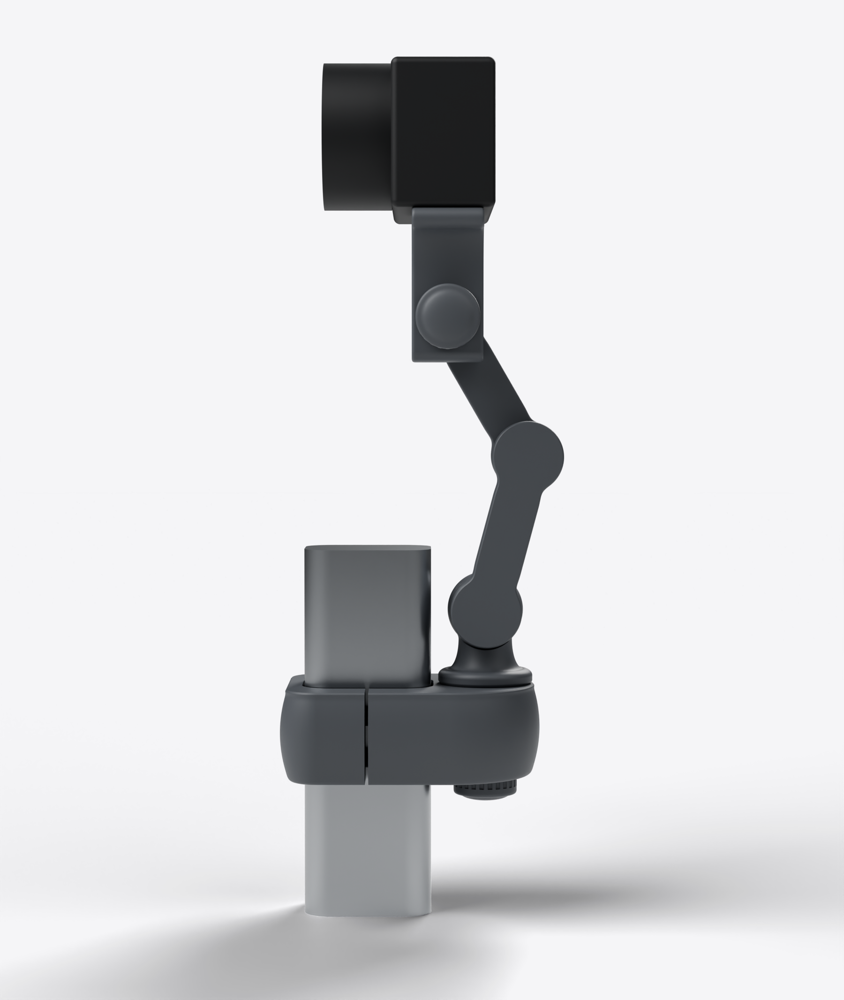
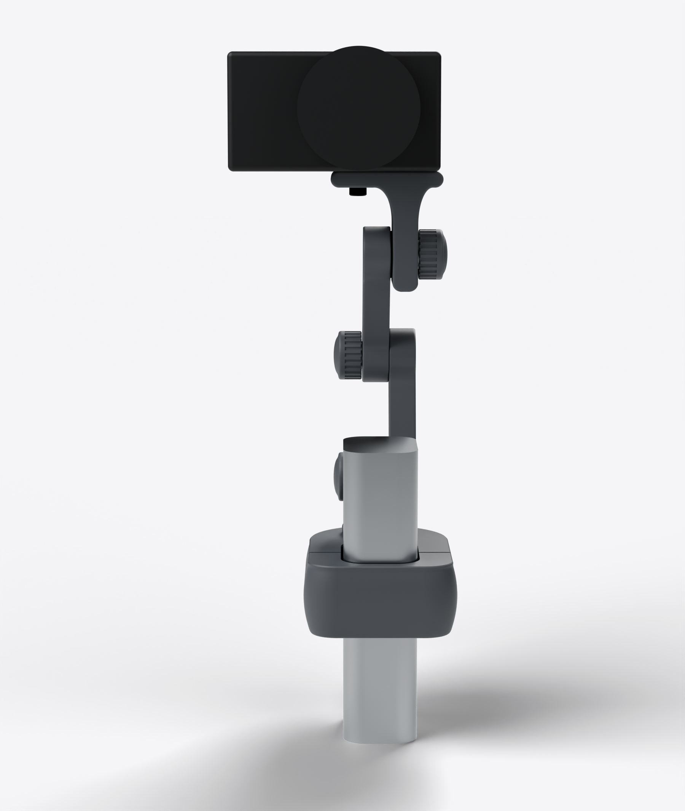
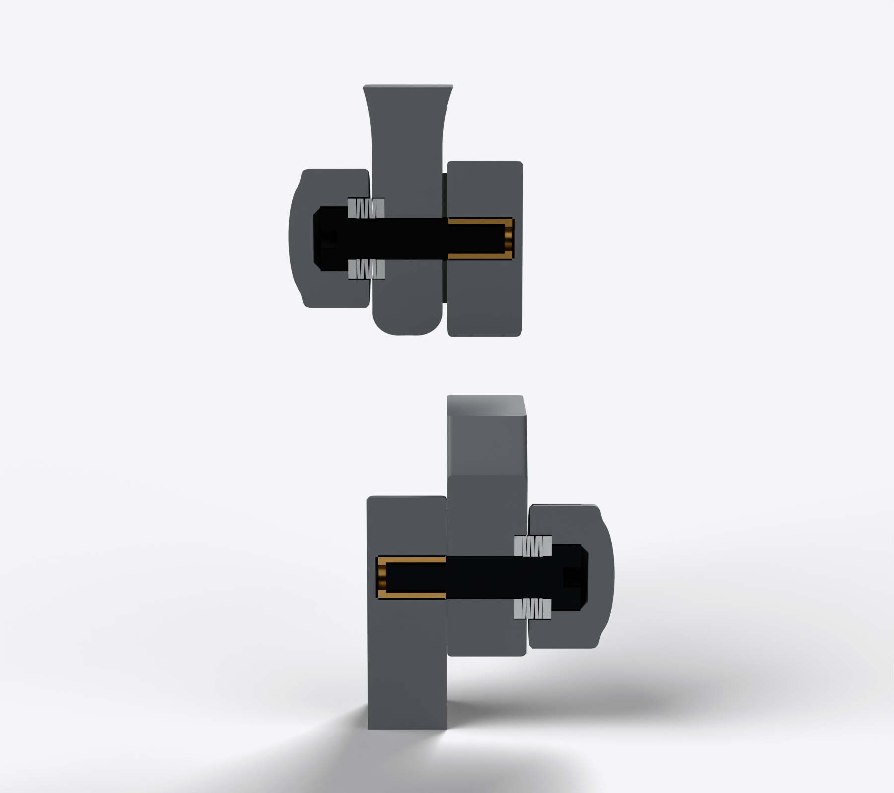
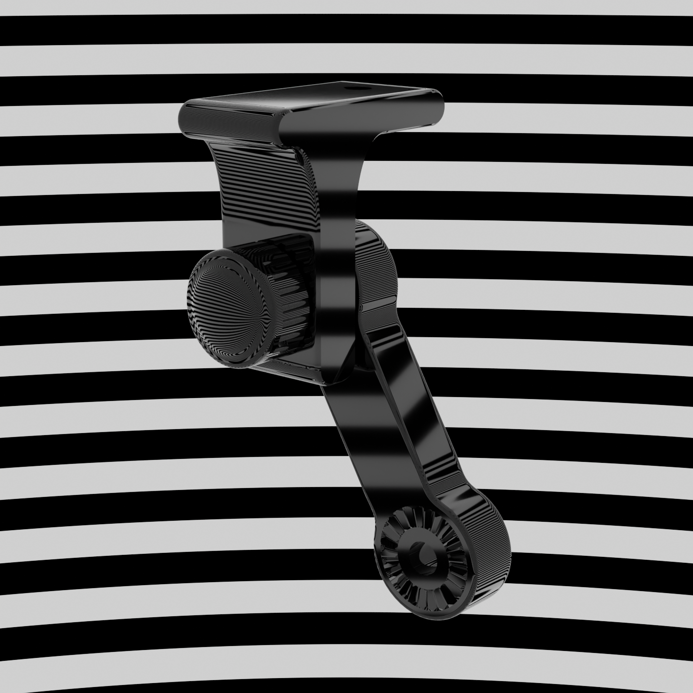
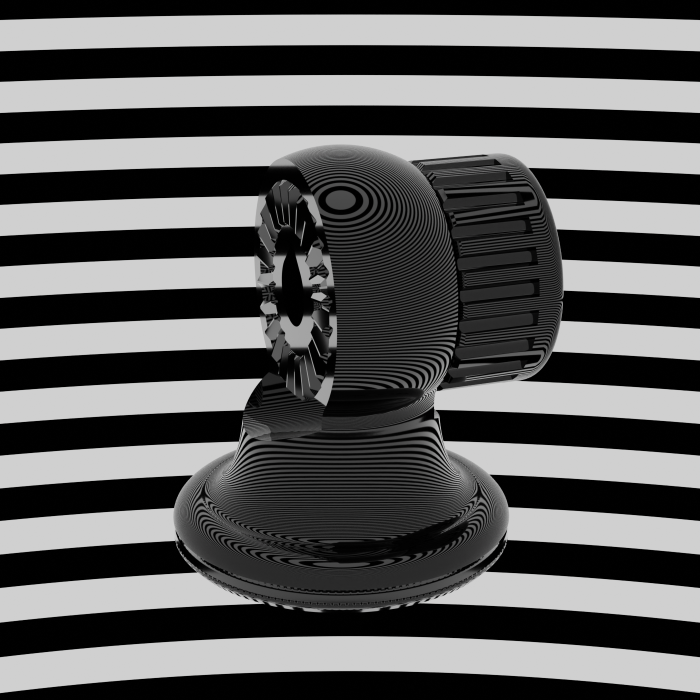
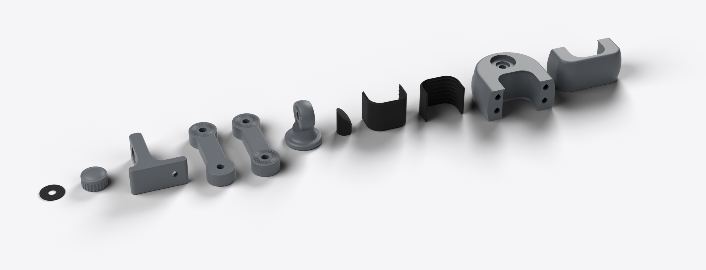

# Monitor stand holder

A PETG collar clamps the monitor-stand column through a TPU grip liner. A turned pedestal pans on the collar's back. Two links on Hirth rosettes set reach and height, and a friction joint gives fine tilt to a head that is also the camera platform. It carries a Sony ZV-E10 with its battery door free.

The pictures are Cycles renders of the solids `python -m holder` checks. They are not photographs. Nothing here has been printed yet.

The design brief is [DESIGN.md](DESIGN.md). PLAN.md is the earlier band-and-block design, kept as history.

## How it works

- **One fastener rule.** Every joint is a spring stop: an ISO 7379 shoulder screw, a stack of DIN 2093 disc springs under its head, and a heat-set insert in the far part. Tighten until it stops. The shoulder then sits on the insert's brass face, so extra torque goes into steel and brass. The PETG and the insert only see the spring force, which the geometry sets and the build measures. The springs also follow the PETG and the TPU as they creep.
- **Pan** on the pedestal, under the collar's back. Loosen the knob under the collar about a turn, pan, and turn it until it stops. With the arm in the hero pose it pans ±30° before the arm meets the column; raise the arm for more.
- **J1, J2** are 24 tooth rosettes, 15° index. Back the knob out about 4 mm, lift 2.2 mm, turn, and tighten.
- **J3** is smooth, on a TPU ring. It holds the camera within ±15° of level. Past that, move J2.
- **Horizon.** Every tilt axis stays horizontal at any pan angle, so the picture stays level on a vertical column. There is no roll joint.
- **Battery door.** The platform sits under the lens end. The door, and 30 mm of room below it for a dummy-battery plug, clear every part.

## Form

- Each part is one surface: a turned profile (pedestal, knob) or one G2 skin (collar, links, head). Milled flats, bores and the seam are crisp cuts with a 0.4 mm lead-in, as on machined camera hardware.
- Second-order curves carry the shapes. The collar wall is a 2 mm parabola, its plan has elliptic corners and a half-ellipse back. The pedestal is a ball, a circular waist, an elliptic flare and an elliptic foot. The head's platform sweeps into its J3 face through a quarter ellipse. The knob crown is an ellipse.
- Every join between those curves is G2. The build measures that on the finished part, on every edge where two faces of the outer surface meet (normal step ≤ 0.5°, curvature step ≤ 2e-3 /mm). The only creases are the 45° leads on print-bed edges.
- Nothing shows on the front. The seam stops enter from the back, under four TPU caps cut from the collar's own surface, so the back reads as one surface too. The other knobs sit on the joints' outer faces, with their springs hidden in spot faces.

| | |
| --- | --- |
|  |  |
| Side: pedestal, links, head and camera. | Front, from the user's side. |
|  |  |
| J2: rosette, knob over its spring stack. | J2 and J3 cut through their axes: shoulder screws, springs, inserts, the TPU ring. |
|  |  |
| The collar and liners. | Plan: the half-ellipse back. |

| | |
| --- | --- |
|  |  |

## Parts

All files in `exports/` are in print pose, bed face on Z = 0, as `.step`, `.stl`, and `.3mf`. `exports/report.json` lists every check row and a hash of `src/`.

| Part | Qty | Material | Print pose (bed face) | Walls / top-bottom / infill | Stress vs layers |
| --- | --- | --- | --- | --- | --- |
| `collar_front` | 1 | PETG | top face down | 5 / 5 / 40 % gyroid | clamp hoop, along |
| `collar_back` | 1 | PETG | top face down | 5 / 5 / 40 % gyroid | back moment, along |
| `liner_front`, `liner_back` | 1 each | TPU 95A | axis vertical, end down | all perimeters, 25 mm/s | compression |
| `seam_cap_1` … `seam_cap_4` | 1 each | TPU 95A, collar colour | inner end down | solid | none: a 0.1 mm press fit |
| `arm_base` | 1 | PETG | foot down | 6 / 6 / 60 % | neck bending, across: checked at 1.9 MPa |
| `arm_link` | 1 | PETG | on its +X face | 6 / 5 / 50 % | waist bending, along |
| `arm_tip` | 1 | PETG | on its +X face | 6 / 5 / 50 % | waist bending, along |
| `arm_head` | 1 | PETG | on its +Y face | 6 / 6 / 60 % | platform and block bending, along |
| `knob` | 4 | PETG | rim down | 4 / 5 / 40 % | hand torque |
| `j3_ring` | 1 | TPU 95A | flat | solid | compression |
| `coupon_*` | 1 each | as parent | as parent | as parent | fit tests only |

Every part passes an overhang check in print pose: no down-facing surface steeper than 45° unless it is a flat ceiling within 5 mm of its edge. Horizontal holes of 6.5 mm and over have a 45° teardrop roof; the M5 insert holes (6.4) stay round. Walls: 1.5 mm PETG, 1.2 mm TPU, and the insert maker's wall round every knurl (M5 2.6, M6 3.3), measured with solid probes.

Stress rows use a 1.0 kg payload (estimated) in the worst pose, both links level. The moment is a vector: bending about both section axes and twist, as von Mises. Sustained stress stays under 0.1 × UTS in the stress direction (PETG 38.5 MPa along layers, 19.0 across, Ultimaker TDS); peak (2×) under 0.25 × UTS.

## Hardware

Generated by `uv run python -m holder --bom`. A test fails if this table drifts from the code.

<!-- bom:start -->
| Qty | Part | Standard | Source |
| --- | --- | --- | --- |
| 1 | 1/4"-20 x 0.5" | ASME B18.3 | Westfield ASME B18.3 table |
| 20 | disc spring 16 x 8.2 x 0.6 | DIN 2093 B | fasten.it DIN 2093 table |
| 24 | disc spring 14 x 7.2 x 0.35 | DIN 2093 C | fasten.it DIN 2093 table |
| 12 | M8 washer | ISO 7089 | Westfield ISO 7089 |
| 1 | M6 large washer | ISO 7093-1 | fasten.it ISO 7093-1 table; Keller & Kalmbach |
| 4 | M5 shoulder screw, 6.5 mm shoulder, l1 35 | ISO 7379 | fasten.it ISO 7379; Elesa ISO 7379 |
| 3 | M6 shoulder screw, 8 mm shoulder, l1 20 | ISO 7379 | fasten.it ISO 7379; Elesa ISO 7379 |
| 1 | M6 shoulder screw, 8 mm shoulder, l1 40 | ISO 7379 | fasten.it ISO 7379; Elesa ISO 7379 |
| 4 | M5 heat-set insert | ruthex RX-M5x9.5 | 3djake ruthex RX-M5x9.5 table |
| 4 | M6 heat-set insert | ruthex RX-M6x12.7 | 3djake ruthex RX-M6x12.7 table |
<!-- bom:end -->

| Stop | Screw | Springs | Into | Force (least .. most) | It holds |
| --- | --- | --- | --- | --- | --- |
| Seam (4) | ISO 7379 M5 × 35, from the back, 3 mm key | 6 × DIN 2093 C 14 × 7.2 × 0.35 on an M8 washer | M5 insert in the front shell | 71 .. 128 N | 2× tilting couple: 33 N each |
| Pan pivot (1) | ISO 7379 M6 × 40, in the knob under the collar | 5 × DIN 2093 B 16 × 8.2 × 0.6, M8 washers | M6 insert in the pedestal | 261 .. 373 N | no lift-off at 2×: 188 N |
| J1, J2 (2) | ISO 7379 M6 × 20, in a knob | 5 × B16, M8 washers | M6 insert in arm_link | 263 .. 375 N | rosette at 2×: 192 N |
| J3 (1) | ISO 7379 M6 × 20, in a knob | 5 × B16, M8 washers, TPU ring | M6 insert in arm_tip | 187 .. 351 N | ring friction at 2×, ±15°: 146 N |
| Camera (1) | 1/4"-20 × 1/2" socket head + ISO 7093 washer | — | ZV-E10 socket, 4.85–5.35 mm engaged | 787 N at 1 Nm by hand | washer bearing 3.61 MPa (limit 3.85) |

The force band covers the shoulder length tolerance (0/+0.25), the printed stack (±0.15, ±0.25 at J3) and, at the seam, a column ±0.3 mm and 0.6 mm of rib crush. The highest load anywhere is an M6 insert at 1.08 MPa pull-out shear against 1.10. There is no torque to set: turn each knob or key until it stops.

Tools: a 3 mm hex key (seam), a 3/16" hex key (camera), a soldering iron with insert tips (inserts, and the knob heads).

## Install

Clamp the collar so the column top is at most **181 mm** above the collar's bottom face. The hero pose reaches back over the column; a taller column hits the arm. The build measures this limit on the solids (`column top limit` row) and the renders show the column ending 100 mm above the collar.

## Assembly

1. Press the inserts with a soldering iron: four M5 into `collar_front`'s seam faces; one M6 into the `arm_base` pivot face, one into each end of `arm_link`, one into end B of `arm_tip`. Melt the knurled head of each M6 shoulder screw into a knob the same way, the hex socket toward the crown.
2. Snap the liners into both shells, behind the lips.
3. Close the shells round the column. At each seam hole on the back: an M8 washer, six C springs alternating cup up, cup down, and an M5 shoulder screw. Turn with a 3 mm key until it stops. Press a TPU cap into each hole, flush.
4. Set `arm_base` on the collar's back. From below: M8 washer, five B springs alternating, M8 washer, then the knob with its 40 mm screw. Turn until it stops.
5. Build J1 (knob on the pedestal's flat side), J2 (knob on `arm_tip`) and J3 (TPU ring between `arm_tip` and the head, knob on the head) the same way, with the 20 mm screws.
6. Set the camera on the platform and drive the 1/4"-20 screw and its washer from below. The key reaches it with the arm built.

## What the build checks

`uv run python -m holder` builds every part, runs every check, and exits 1 before writing anything if one fails. Then it writes STEP, STL, and 3MF, reads each one back (STEP volume within 0.5 %, 3MF within 1 %), removes exports of parts that no longer exist, and writes `exports/report.json`. The same checks run in `uv run pytest`, each with a case that must fail.

- Every part is one valid solid; overhangs and walls in print pose.
- The finished part's outer surface is G2 at every join between its own faces; plan and profile curves too.
- Every insert: the maker's wall round the knurl, and a blind hole deep enough (a through hole fails).
- Every stop, measured by rays on the placed solids: seat to insert top is the design length; spring deflection inside 0.15–0.95 h0 over the whole tolerance band; least force covers what the joint must hold; most force under the insert pull-out and washer bearing limits; the shoulder lands on brass; thread length at the stop, room past the tip, and thread left when backed out to re-index.
- The camera screw: grip by rays, engagement, tip depth, washer bearing at 1 Nm; the battery door and its swing room clear.
- The hero assembly, column and bought parts included: every pair shares at most 1e-6 mm³, except a screw in its own insert, an insert in its host and a screw head in its knob. Liner rib tips touch the column (0.02 ± 0.01) with the shells closed to contact.
- The rosettes mesh with 0 clash and a 0.05 to 0.15 mm flank gap; the TPU ring sits 0 to 0.03 mm off both J3 faces; every tilt axis is square to the pan axis.
- Pan and each joint swept through 360° in 15° steps: the hero and folded poses are inside the clear range (pan in the hero pose −30° to 30° and 150° to 195°, where the arm misses the column; J1 −30° to 105°; J2 300° round to 195°; J3 255° round to 120°).
- A key rod (key + 1 mm, 120 mm) from each keyed screw misses every part present at that assembly step; 10 mm of finger room round every knob.
- Section stress at the collar back, pedestal neck, link and tip waists, head block and platform root.
- The install limit: how high the column may run above the collar.

Passing CAD checks is not a printed fit. Print the coupons first, then do a 24 h hang test with the camera before trusting the arm.

## Coupons

Each coupon is a slice of the real part, so its fit is the real fit. The ring coupons are checked against the measured column, not against the part they came from.

- `coupon_collar_front`, `coupon_collar_back`, `coupon_liner_front`, `coupon_liner_back`: the ring from z 4 to 19.5 with the lower seam stops (z 10). Test the clamp on the column, the M5 inserts and the stop.
- `coupon_rosette_base`, `coupon_rosette_link`: the pedestal's J1 flat and arm_link's end A with its insert. Build J1 on them with a knob and five springs: test the teeth, the stop, the lift, and that the melted head holds when you turn hard at the stop.

After the coupons:

- Collar loose on the column: lower `column_d` by 0.5 mm. Too tight: raise it.
- Insert loose or cracking the wall: change the insert's `hole_d` in `params.py`.
- Teeth do not seat: raise `flank_fit` by 0.05 mm.
- A joint too stiff or too weak: change its spring count or `J_TARGET` in `arm.py`; the force rows follow.

## Open items (estimated until measured)

| Item | Value used | How to close |
| --- | --- | --- |
| Column corner radius | r 12 | Collar coupon |
| Column depth band | ±0.3 | Calipers |
| ruthex hole and knurl | M5 6.4 / 7.1, M6 8.0 / 8.7 (table columns not labeled) | ruthex datasheet, the coupons |
| Melted shoulder head in the knob | holds hand torque | Rosette coupon |
| Printed stack tolerance | ±0.15 mm (ring ±0.1) | Measure the coupons |
| Payload | 1.0 kg | Weigh the camera and lens |
| Friction: TPU on aluminium, PETG on PETG, TPU ring on PETG | μ 0.5, 0.2, 0.5 | Coupon pull tests |
| ZV-E10 socket offset and door size | socket 13 mm toward the lens, door 36 × 24 at the grip end | Calipers |

## Commands

| Command | What it does |
| --- | --- |
| `uv sync` | Install build123d 0.11 and the dev tools (Python 3.12) |
| `uv run python -m holder` | Check, then write `exports/` and line previews in `out/` |
| `uv run python -m holder --bom` | Print the hardware table |
| `uv run pytest` | Every check, the negative cases, and the README BOM |
| `uv run ruff check src tests tools` | Lint |
| `uv run --with pillow python tools/render/meshes.py` | Cycles renders into `docs/renders` (needs flatpak `org.blender.Blender` 5.2) |

## Layout

`src/holder/params.py` holds every dimension, with the source of each bought part. `form.py` holds the curves: G2 corners and blends, the turtle of conics, skins and turned bodies, the curvature probe. `stops.py` is the spring-stop joint: its design length, force band, solids and rows. `common.py` holds the checks, inserts, bearing and section probes, the surface-continuity probe and the bought solids. `collar.py` and `arm.py` build parts and return `checks()`; they never export. `assembly.py` places everything, measures the stops, loads, sweeps and the install limit. `export.py` writes files and does not repair geometry.
